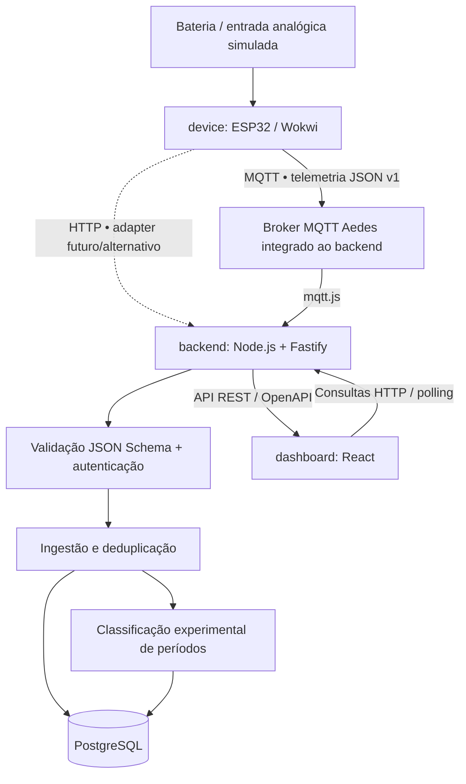

# Plataforma IoT para Monitoramento de Baterias

**Versão da especificação:** 1.0  
**Estado:** MVP demonstrável implementado; integração com PostgreSQL e firmware devem ser executados no ambiente local
**Contexto:** Projeto Integrador VI — UNIVESP; estudo de caso em operação logística industrial  
**Horizonte de implementação:** 14 dias  
**Dispositivo-alvo:** ESP32, inicialmente simulado no Wokwi

> Esta v1.0 é um protótipo **observacional e de simulação**. O firmware usa um potenciômetro Wokwi, o dashboard mostra medições marcadas como simuladas e os parâmetros da operação real ainda dependem de caracterização e autorização. Não conectar o circuito a baterias reais.

## 1. Objetivo

Desenvolver uma plataforma IoT capaz de **monitorar a tensão de baterias de equipamentos de movimentação de cargas**, registrar séries históricas, comparar equipamentos, identificar alertas e acompanhar **períodos prováveis de carga e descarga**.

Cada dispositivo IoT monitora **um equipamento e sua bateria ativa por vez**. O cadastro distingue **dispositivo**, **equipamento** e **bateria**, preservando o histórico quando houver substituição da bateria ou transferência do monitor.

O sistema é **exclusivamente observacional**: não comanda carregadores, não interfere no controle do equipamento e não substitui seus sistemas de segurança. A medição de tensão em operação permite observar tendências, mas **não determina com precisão o estado de carga (SoC), a saúde (SoH) nem o número de ciclos equivalentes completos**. Na v1.0, a classificação de carga/descarga baseada apenas em tensão será **inferida e experimental**, não uma medição confirmada de ciclos eletroquímicos.

### Entregas de v1.0

- Firmware ESP32 simulável no Wokwi, adquirindo e normalizando tensão periodicamente.
- Publicação de mensagens MQTT com contrato JSON Schema versionado.
- Backend Node.js/TypeScript que recebe telemetria, valida, deduplica e armazena dados no PostgreSQL.
- Associação temporal entre dispositivos, equipamentos e baterias.
- Dashboard React com visualização do valor atual, histórico, comparações e alertas.
- Identificação experimental dos períodos prováveis de carga, descarga e estado indeterminado.
- Buffer de medições durante perda de conectividade e reenvio após reconexão.
- Testes de integração e documentação de contratos, decisões e limites da simulação.

## 2. Princípios de arquitetura

1. **Contract-first:** mensagens IoT em JSON Schema e API HTTP em OpenAPI 3.1, mantidas fora dos três projetos executáveis.
2. **Baixo acoplamento:** aquisição, transmissão, ingestão, domínio, persistência e visualização se comunicam por interfaces claras.
3. **Ports & Adapters:** drivers, transportes e repositórios são implementações substituíveis de portas estáveis.
4. **Monólito modular:** um processo de backend Node.js, com separação lógica entre módulos, sem microsserviços nesta fase.
5. **Reutilização:** o firmware pode usar outros sensores; o backend pode ingerir dados de outros dispositivos; a API pode ser consumida por outros clientes.
6. **Rastreabilidade:** a origem, a bateria associada, a data da coleta e a versão do contrato de cada medição devem ser recuperáveis.
7. **Resiliência:** aquisição independe da conexão; retransmissões não produzem registros duplicados.
8. **Evolução segura:** esquemas são versionados e mudanças incompatíveis exigem nova versão de contrato.

## 3. Arquitetura geral



**Fluxo de escrita:** ESP32 → MQTT → broker → consumidor Node.js → validação → associação à bateria → persistência → análise.  
**Fluxo de leitura:** dashboard → API REST Node.js → banco de dados → gráficos e indicadores.

O **React não se conecta diretamente** ao broker MQTT nem ao PostgreSQL. A comunicação do dashboard com o backend é feita por **REST/JSON**, com *polling* periódico. A API e o broker desta demonstração não têm autenticação e não devem ser expostos à rede.

### Stack tecnológica

| Área | Escolha para v1.0 | Papel |
| --- | --- | --- |
| Microcontrolador | ESP32 DevKit | Aquisição e conectividade |
| Firmware | C++ / Arduino Framework | Drivers e regras embarcadas |
| Simulação | Wokwi | Circuito, leituras e testes preliminares |
| Acesso à rede | Wi-Fi | Transporte IP |
| Protocolo IoT | MQTT 3.1.1 (QoS 1) | Telemetria do dispositivo |
| Broker | Aedes embutido no backend | Recepção MQTT no próprio processo da API |
| Backend | Node.js LTS + TypeScript | Serviços de aplicação |
| API HTTP | Fastify | Endpoints REST |
| Consumidor MQTT | mqtt.js | Assinatura de tópicos |
| Validação | JSON Schema Draft 2020-12 + Ajv/ajv-formats | Contratos e consistência de mensagens |
| Documentação HTTP | OpenAPI 3.1 | Contrato de API pública |
| Persistência | PostgreSQL + Drizzle ORM | Histórico, índices e migrações |
| Dashboard | React + TypeScript + Vite | Interface web |
| Gráficos | Recharts | Séries temporais e comparativos |
| Testes | Vitest + testes de integração | Regras e contratos |
| Ambiente local | Docker Compose | Broker, banco e serviços |
| Colaboração | Git + GitHub | Código e histórico de decisões |

O relatório parcial prevê ESP32 e avalia Wi-Fi, MQTT/HTTP, bancos relacionais e dashboard próprio; as demais ferramentas são **decisões propostas para a implementação v1.0**, não escolhas já exigidas pelo relatório.

## 4. Monorepositório

As aplicações executáveis, contratos e infraestrutura compartilhada estão organizados assim:

```text
battery-monitoring-iot/
├── package.json                    # Workspaces e comandos comuns
├── .env.example
├── device/                         # Firmware ESP32 / Wokwi
│   ├── platformio.ini
│   ├── src/{config.h,main.cpp}
│   ├── simulator/                   # Simulador MQTT (CLI e Painel Web em http://localhost:4000)
│   ├── wokwi.toml
│   └── wokwi/diagram.json
├── backend/                        # Node.js / Fastify
│   ├── src/adapters/{database,http,mqtt}/
│   ├── src/db/{schema.sql,migrate.ts,seed.ts}
│   ├── src/domain/types.ts
│   ├── src/modules/{cycles,telemetry}/
│   └── README.md
├── dashboard/                      # React / Vite / Recharts
├── contracts/                      # JSON Schema e OpenAPI
├── infra/                           # PostgreSQL local (Compose)
└── docs/                            # Arquitetura e validação
```

Os diretórios executáveis têm dependências independentes. `contracts/` contém **especificações**, não lógica de negócio nem bibliotecas dependentes do Node.js.

## 5. Modelo de domínio

| Entidade | Responsabilidade |
| --- | --- |
| `devices` | Identificar cada ESP32, versão de firmware e status |
| `equipment` | Representar equipamento industrial monitorado |
| `batteries` | Identificar bateria física, tecnologia e tensão nominal |
| `device_assignments` | Registrar vínculo temporal de dispositivo a equipamento |
| `battery_assignments` | Registrar vínculo temporal de bateria a equipamento |
| `measurements` | Persistir leituras com origem, timestamp, valor e bateria atribuída |
| `measurement_metrics` | Preservar cada grandeza do envelope extensível |
| `battery_periods` | Guardar períodos **inferidos** de carga, descarga ou estado indeterminado, atualizados quando consultados |
| `alerts` | Guardar violações de limiar e outras ocorrências |

### Regras de associação

- Na v1.0, cada dispositivo monitora **um equipamento ativo** e cada equipamento possui **uma bateria monitorada ativa** por vez.
- Transferências e substituições encerram a associação anterior e abrem uma nova; **nunca apagam medições antigas**.
- O backend resolve a bateria de cada medição pela associação vigente no **instante da coleta**.
- Uma medição sem associação inequívoca é mantida para análise/quarentena, em vez de ser atribuída a uma bateria errada.
- Restrições e índices no banco impedirão associações ativas conflitantes; `device_id + message_id` identifica unicamente um evento recebido.

## 6. Contrato de telemetria

Arquivo canônico previsto: `contracts/telemetry/v1/measurement.schema.json`.

Exemplo ilustrativo de mensagem válida para o contrato v1 planejado:

```json
{
  "schema_version": "1.0",
  "message_id": "esp32-001-000042",
  "device_id": "esp32-001",
  "timestamp": "2026-10-15T12:00:00Z",
  "metrics": [
    {
      "name": "battery.voltage",
      "value": 24.5,
      "unit": "V",
      "quality": "simulated"
    }
  ]
}
```

**Semântica mínima:**

- `schema_version`: versão compatível do formato.
- `message_id`: identificador estável da medição, preservado em reenvios.
- `device_id`: origem técnica do evento, cadastrada no backend.
- `timestamp`: instante da **aquisição** em UTC; o backend registra separadamente o instante do recebimento.
- `metrics`: coleção extensível de grandezas, com nome, valor numérico, unidade e qualidade da leitura.

A atribuição de `equipment` e `battery` é realizada **no servidor**, conforme as associações temporais. Isso evita tornar a identidade da bateria fixa no firmware. O backend rejeita timestamps inválidos ou mais de cinco minutos no futuro. O firmware aguarda sincronização NTP antes de adquirir uma amostra com timestamp.

### Tópico MQTT implementado

```text
telemetry/v1/{device_id}/measurements
```

A identidade do tópico deve corresponder ao `device_id` do payload; o consumidor rejeita divergências. O dispositivo publica com QoS 1 e o backend deduplica pela combinação `device_id + message_id`. O broker local de desenvolvimento não autentica clientes.

### Extensibilidade

Outros sensores poderão usar o mesmo envelope, por exemplo `temperature` com unidade `Cel`. Valores de tensão devem usar `battery.voltage` em `V`. Novas grandezas exigem aquisição/calibração própria e, se necessário, novos consumidores analíticos, sem alterar os módulos genéricos de ingestão.

## 7. Contrato REST entre backend e dashboard

A API está documentada em `contracts/openapi/api.v1.yaml`.

| Método | Endpoint | Função |
| --- | --- | --- |
| `GET` | `/api/v1/devices` | Listar dispositivos |
| `GET` | `/api/v1/equipment` | Listar equipamentos |
| `GET` | `/api/v1/batteries` | Listar baterias |
| `GET` | `/api/v1/equipment/{id}/measurements?from=&to=` | Consultar até 2.000 medições do histórico |
| `GET` | `/api/v1/batteries/{id}/periods?from=&to=` | Inferir períodos a partir das medições |
| `GET` | `/api/v1/alerts?equipment_id=&from=&to=` | Consultar alertas |
| `POST` | `/api/v1/measurements` | Ingestão HTTP alternativa |

O dashboard consulta a API por HTTP com atualização periódica e não acessa diretamente o broker MQTT ou PostgreSQL. A API local ainda não implementa autenticação: use somente no ambiente demonstrativo isolado.

## 8. Identificação de períodos de carga e descarga

O módulo `backend/src/modules/cycles/` classifica períodos prováveis com base na inclinação entre medições consecutivas e atualiza a tabela `battery_periods` quando o endpoint de períodos é consultado:

- `charging`: elevação sustentada compatível com possível recarga.
- `discharging`: queda sustentada compatível com possível descarga.
- `unknown`: repouso, oscilação, dados insuficientes ou comportamento ambíguo.

O limiar de inclinação é configurável pela variável `CYCLE_MIN_CHANGE_PER_MINUTE`; o valor padrão existe apenas para a demonstração. A classificação atual não implementa filtragem nem histerese e não estabelece parâmetros universais: bateria, tensão nominal, regime de operação e caracterização elétrica do estudo de caso seguem pendentes.

**Limitação essencial:** aumento de tensão pode representar recuperação após retirada de carga, e queda pode resultar de demanda transitória do motor. Portanto, os eventos inferidos não devem ser anunciados como confirmação de recarga, SoC, SoH ou contagem de ciclos completos. Medição adicional de corrente ou indicação do carregador poderá aprimorar a classificação em versões futuras.

## 9. Resiliência, segurança e integridade

- **Buffer local:** o ESP32 mantém em RAM até 32 medições; quando cheio, descarta a mais antiga e registra a ocorrência no Serial. A fila não sobrevive a reinicialização.
- **Reenvio:** após reconexão, o dispositivo transmite os registros pendentes com QoS 1, aguardando confirmação do broker; o ID usa contador reservado em blocos na NVS.
- **Deduplicação:** o banco aplica uma chave única composta por `device_id` e `message_id`.
- **Validação:** todas as mensagens são validadas contra a versão apropriada do JSON Schema, com verificação adicional de identidade, unidade, faixa plausível e associação temporal.
- **Credenciais:** o broker local e a API do protótipo não têm autenticação; não os exponha fora da máquina de desenvolvimento.
- **Criptografia:** TLS e gestão de credenciais não estão implementados no protótipo; são obrigatórios antes de qualquer uso fora do simulador/local.
- **Observabilidade:** logs de falha, rejeição, reconexão e atraso de entrega.
- **Hardware real:** **nunca conectar a tensão da bateria diretamente ao ADC**. São necessários dimensionamento de divisor/proteções, análise de ruído, aterramento e eventual isolamento, com validação elétrica e autorização operacional antes de testes em campo.

A simulação no Wokwi **não comprova** precisão metrológica, proteção contra transientes, robustez mecânica ou segurança de uma instalação industrial.

## 10. Desenvolvimento e execução local

### Pré-requisitos

- Node.js 22+ e npm.
- Docker Engine e Docker Compose para PostgreSQL.
- PlatformIO Core/VS Code para compilar o firmware; Wokwi para simular o circuito.

### Fluxo esperado

1. Copiar `.env.example` para `.env` na raiz e manter a configuração apenas local.
2. Instalar dependências com `npm install`.
3. Subir PostgreSQL: `docker compose -f infra/compose.yaml up -d postgres`.
4. Criar o schema e as medições sintéticas: `npm run migrate --workspace backend` e `npm run seed --workspace backend`.
5. Iniciar API e dashboard em terminais distintos: `npm run dev:backend` e `npm run dev:dashboard`.
6. Abrir `http://localhost:5173`; o Vite encaminha `/api` para a API local.
7. Para testar o ESP32, configurar `device/src/config.h`, compilar com `pio run` dentro de `device/` e abrir o projeto `device/wokwi.toml`.

Para testar dispositivos e injetar telemetria MQTT sem necessidade de PlatformIO/Wokwi ou Docker:

- **Painel Web de Simulação Multi-Dispositivos (Recomendado):**
  Execute `npm run device:simulate:ui` (ou `npm run simulate:ui --workspace device`) e abra **`http://localhost:4000`**.
  - Permite ligar/desligar transmissões individualmente (`esp32-001`, `esp32-002`) ou em lote ("Ligar Todos" / "Desligar Todos").
  - Suporta criação dinâmica de novos dispositivos ESP32 em tempo de execução.
  - Ajuste dinâmico de taxas de dreno em tempo real (dreno normal de 0 a 0,05 V e dreno acelerado em subtensão de 0,05 a 0,10 V).
  - Intervalos de publicação ajustáveis com atalhos (1s, 2s, 5s) e limiares de tensão configuráveis.
  - Botão de troca imediata de bateria ("Trocar Bateria 🔄") para testar os algoritmos de detecção de ciclo no dashboard.
  - Interface com suporte a Tema Claro (padrão) e Tema Escuro.

- **Simulador em Linha de Comando (CLI):**
  Execute `npm run device:simulate` para iniciar uma transmissão contínua no terminal. Consulte [device/README.md](./device/README.md) para detalhes.

**Broker MQTT:** o backend inicia seu próprio broker TCP na porta `MQTT_PORT` (padrão `1883`) e conecta seu consumidor internamente. Por padrão, ele escuta apenas em `127.0.0.1`. Para receber conexões externas do Wokwi, configure `MQTT_BIND_HOST=0.0.0.0` e `MQTT_HOST` no firmware com um endereço alcançável pelo simulador; a API e o broker não têm autenticação/TLS, portanto use apenas uma rede isolada de desenvolvimento e não os exponha à internet.

Os detalhes do firmware e da tela de controle estão em `device/README.md`; comandos da API e verificação estão em `backend/README.md` e `docs/testing.md`.

Para demonstrar a API, o broker MQTT e o dashboard sem Docker/PostgreSQL, defina `$env:DEMO_IN_MEMORY = "true"` no terminal PowerShell (ou `DEMO_IN_MEMORY=true` no Linux/macOS) antes de executar `npm run dev:backend`. O modo em memória gera medições sintéticas iniciais e ingere telemetria MQTT em tempo real.

## 11. Testes e critérios de aceite

- [ ] ESP32 simulado realiza leituras e publica mensagens conforme o JSON Schema v1.
- [x] Backend valida payloads e rejeita mensagens inválidas com logs apropriados.
- [x] Duas unidades simuladas publicam telemetria separadamente (suportado pelo Painel Web e pelo gerador de simulação).
- [x] Cada medição é associada ao equipamento e à bateria corretos na data da coleta.
- [x] Duplicações por retransmissão não criam novos registros (teste do adapter HTTP em memória; integração PostgreSQL pendente).
- [ ] Perda de rede não interrompe a aquisição, e o buffer é reprocessado após reconexão.
- [x] API devolve dados por equipamento, bateria e período no modo demonstrativo.
- [x] Backend inicia broker MQTT embutido e ingere telemetria publicada por MQTT (teste de integração local).
- [x] Dashboard apresenta tensão atual, histórico, comparação e alertas no modo demonstrativo.
- [x] Classificação experimental distingue tendências prováveis e mantém estado indeterminado nos testes do módulo.
- [x] Inclusão de outras métricas no mesmo envelope; são persistidas em `measurement_metrics`, sem alterar o núcleo de ingestão.
- [x] Testes automatizados de schema, regras de domínio, API e deduplicação no adapter em memória passam.
- [ ] Integração real com PostgreSQL, firmware no Wokwi e conexão externa ao broker embutido: requer Docker, PlatformIO e conectividade alcançável; ainda não validada neste ambiente.
- [x] README e documentação refletem a implementação real e as limitações observadas.

## 12. Plano de execução — 14 dias

| Dias | Foco | Entregável |
| --- | --- | --- |
| 1–2 | Scaffold do monorepo, JSON Schema, OpenAPI e modelo relacional | Contratos e esqueleto das três aplicações |
| 3–4 | Backend, MQTT e persistência | Ingestão por mensagens simuladas |
| 5–6 | ESP32/Wokwi, leitura e envio | Primeiro fluxo ponta a ponta |
| 7–8 | Dashboard, séries históricas, associação de bateria | Gráficos por equipamento/bateria |
| 9–10 | Buffer/reenvio, deduplicação e alertas | Resiliência e regras operacionais |
| 11–12 | Classificação experimental e teste de extensibilidade | Períodos inferidos e sensor adicional |
| 13–14 | Testes integrados, documentação e demonstração | MVP v1.0 demonstrável |

**Prioridade:** (P0) ingestão e histórico ponta a ponta; (P1) associação de bateria, dashboard, resiliência e alertas; (P2) refinamentos analíticos e segundo adapter de transporte. Se houver restrição de prazo, preservar P0/P1 e registrar explicitamente o que ficou fora da entrega.

## 13. Limites de escopo e evolução

**Dentro da v1.0:** medição de tensão, histórico, comparações, alertas, associação entre ativos, classificação *inferida* de períodos e demonstração em simulador.

**Fora da v1.0:** controle de carga, intervenção no equipamento, cálculo certificado de SoC/SoH, medição industrial homologada, previsão confiável de vida útil, manutenção preditiva validada em campo, infraestrutura de múltiplos clientes e garantia de conectividade industrial.

Evoluções possíveis incluem medição de corrente/temperatura, ADC externo, transportes alternativos, integração com sistemas corporativos e implantação em múltiplas unidades.

## 14. Origem dos requisitos

Este projeto parte do **Relatório Parcial Técnico-Científico do Projeto Integrador VI (UNIVESP, 2026)**, *Plataforma IoT para Monitoramento de Baterias em Equipamentos de Movimentação de Cargas: Um Estudo de Caso em Operação Logística Industrial*.

Correspondência com o relatório:

- **RF01–RF03:** aquisição periódica, identificação temporal e transmissão de medições.
- **RF04–RF07:** persistência, gráficos, comparação e alertas.
- **RNF01–RNF05:** não invasividade, buffer local, robustez, responsividade e custo de replicação.

A distinção explícita entre `devices`, `equipment`, `batteries` e associações temporais, bem como o módulo de classificação experimental de períodos e a stack Node.js/React, são **decisões de arquitetura desta especificação v1.0**, elaboradas a partir das necessidades discutidas para a implementação.

---

**Status de entrega:** MVP de demonstração implementado. Build web/backend e testes automatizados aprovados; execução com Docker, compilação Wokwi, conexão externa ao broker e validação em campo permanecem pendentes.
